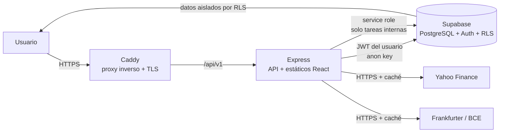

# 01 · Arquitectura y decisiones

## 1. Resumen

Aplicación web multiusuario para gestionar una cartera personal de acciones, ETF y criptomonedas. Cada usuario tiene una única cuenta con sus operaciones, dividendos, activos y preferencias. La aplicación calcula posiciones, plusvalías realizadas y no realizadas, dividendos y rendimiento, con la moneda base configurable por el usuario (EUR por defecto) y conversión desde cualquier divisa soportada.

El acceso es **solo por invitación**: no existe registro público ni panel de administración dentro de la aplicación. El propietario del servidor crea las invitaciones con un comando y envía el enlace al nuevo usuario.

## 2. Stack elegido

| Capa | Tecnología | Motivo |
|---|---|---|
| Backend | Node.js 22 LTS + Express 5 + TypeScript | Requisito del proyecto; TypeScript reduce errores en cálculos financieros y contratos de API. |
| Base de datos | Supabase (PostgreSQL 15+) | PostgreSQL gestionado, copias de seguridad, Row Level Security y Auth integrados. Evita administrar un servidor de base de datos propio. |
| Autenticación | Supabase Auth (email + contraseña) | Hash de contraseñas, límites de intentos, verificación y sesiones gestionadas por GoTrue. No almacenamos contraseñas. |
| Frontend | React 19 + Vite + TypeScript | Dashboard interactivo con tablas, filtros y gráficos; compilado estático servido por Express. |
| Estilos | Tailwind CSS | Diseño consistente, tema claro/oscuro y desarrollo rápido sin CSS artesanal. |
| Gráficos | Recharts | Gráficos declarativos, ligeros y suficientes para evolución, distribución y comparación. |
| Estado remoto | TanStack Query | Caché, reintentos y estados de carga/error homogéneos. |
| Formularios | React Hook Form + Zod | Validación en cliente y reutilización de esquemas con el servidor. |
| Cálculos | `decimal.js` en servidor | Evita errores de coma flotante en importes y cantidades. |
| Pruebas | Vitest + Supertest | Pruebas unitarias de cálculos y de integración de la API. |
| Despliegue | Docker Compose + Caddy | Un contenedor para la app y otro para el proxy con HTTPS automático (Let's Encrypt). |

**Alternativa descartada:** base de datos PostgreSQL autoalojada. Añade backups, actualizaciones y endurecimiento del servidor sin aportar nada al objetivo. Supabase cubre persistencia, autenticación y aislamiento con menos operación. Si en el futuro se quiere autohospedar, Supabase puede ejecutarse con Docker sin cambiar el esquema.

## 3. Arquitectura de despliegue



- El navegador solo habla con el mismo origen (Caddy → Express). No hay CORS.
- Express sirve la compilación de React y la API bajo `/api/v1`.
- Las cookies de sesión son `HttpOnly`, `Secure` y `SameSite=Lax`; el frontend nunca ve los tokens.
- Las tareas internas (invitaciones, refresco de precios) usan la `service_role` key, que nunca sale del servidor.

## 4. Decisiones clave

| Tema | Decisión | Motivo |
|---|---|---|
| Registro | Solo por invitación, creadas con un CLI | Servidor personal expuesto a internet; evita spam y altas no deseadas. |
| Sesión | Access token de 15 min + refresh token de 7 días con rotación, en cookies `HttpOnly` | Cumple JWT de vida corta y evita exponer tokens a XSS. |
| Método de coste | Global por usuario: FIFO (por defecto) o coste medio | Más simple y suficiente para una cartera personal. Se puede cambiar y se recalcula. |
| Moneda base | Configurable por usuario (EUR por defecto) | El usuario puede vivir en otra zona monetaria sin cambiar el código. |
| Divisas | Lista cerrada de divisas principales (ISO 4217) | Evita tipos de cambio inventados y mantiene válidos los cálculos. |
| Conversión | Tipo de cambio **EUR por unidad** guardado en cada operación y dividendo | Congela el cambio histórico y permite recalcular sin depender del proveedor. |
| Datos derivados | No se almacenan: posiciones, plusvalías y rendimiento se calculan al leer | Evita inconsistencias al editar o borrar operaciones. El volumen es pequeño. |
| Precios | Yahoo Finance + caché en base de datos + precio manual opcional | Gratuito y suficiente; la caché y el modo manual evitan que un fallo rompa el dashboard. |
| Benchmark | Símbolo configurable por usuario; por defecto `URTH` (MSCI World) | Comparación útil sin fijar un índice arbitrario. |
| Activos | Metadatos por usuario (símbolo, sector, país, tipo) | Cada usuario puede clasificar sus activos sin afectar a otros. |
| Cuentas | Exactamente una por usuario | Requisito del proyecto; se garantiza con `UNIQUE(user_id)`. |
| Invitaciones | Tabla propia + enlace generado por CLI | No depende de que el SMTP de Supabase esté configurado; el enlace se envía a mano. |
| Dinero en JSON | Importes como cadenas decimales, nunca `number` | Evita pérdida de precisión al serializar. Los gráficos convierten a número solo para dibujar. |

## 5. Seguridad

- **Contraseñas:** nunca se almacenan en la aplicación; las gestiona Supabase Auth con hash.
- **Sesión:** cookies `HttpOnly` + `Secure` + `SameSite=Lax`; access token de 15 minutos y refresh con rotación. El refresh token se revoca al cerrar sesión. Un access token robado caduca como máximo en 15 minutos.
- **CSRF:** `SameSite=Lax` bloquea peticiones mutantes cruzadas y se valida `Origin`/`Sec-Fetch-Site` en todas las peticiones no `GET`.
- **XSS:** React escapa por defecto; no se usa `dangerouslySetInnerHTML`. Helmet aplica CSP, `X-Content-Type-Options`, `Referrer-Policy` y HSTS.
- **Fuerza bruta:** límite por IP y por email en login, registro y recuperación; bloqueo temporal tras fallos repetidos. Supabase Auth añade sus propios límites.
- **Aislamiento:** RLS activo en todas las tablas de usuario; el servidor usa el JWT del usuario en cada consulta y añade filtros explícitos por `user_id`. La `service_role` solo se usa en tareas internas.
- **Secretos:** todo en variables de entorno del servidor; `.env` fuera del repositorio. La `anon key` puede ser pública, la `service_role` no.
- **Validación:** Zod en cliente y servidor; límites de tamaño de cuerpo (100 KB) y de longitud de campos.
- **Errores:** no se filtran trazas ni datos internos al cliente; los 404 no revelan si un recurso existe para otro usuario.
- **Logs:** sin tokens, contraseñas ni datos personales; identificador de petición para correlacionar.

## 6. Divisas y precios

- **Pivote EUR:** todos los tipos de cambio se normalizan a `1 EUR = X divisa` y se guardan con la fecha. Cualquier conversión pasa por EUR.
- **Snapshot:** cada operación y dividendo guarda `fx_rate_eur` (EUR por 1 unidad de su divisa) y `fx_rate_date`. Así el coste histórico no cambia si mañana varía el cambio.
- **Proveedor de divisas:** Frankfurter (tipos del BCE, sin clave) como opción principal; capa de abstracción para cambiarlo.
- **Precios:** Yahoo Finance para cotización actual e histórico diario. Caché de 15 minutos para la cotización actual y cierre diario persistido.
- **Fallo del proveedor:** se sirve el último dato cacheado con aviso `PRICE_STALE`; el dashboard nunca falla por culpa de Yahoo. Si un activo no tiene precio, el usuario puede activar `price_mode = MANUAL` e introducirlo a mano.
- **Transparencia:** la interfaz muestra el tipo de cambio aplicado, su fecha y su fuente en cada operación y en el dashboard.

## 7. Cálculos financieros

- **FIFO:** cada compra crea un lote con su coste unitario en EUR (precio + comisiones prorrateadas). Cada venta consume los lotes más antiguos; la plusvalía realizada es el importe neto de la venta menos el coste de los lotes consumidos.
- **Coste medio:** coste medio ponderado en EUR que se actualiza con cada compra; la venta realizada usa ese coste medio.
- **Moneda:** se convierte cada operación a EUR con el cambio de su fecha antes de aplicar el método. Así se captura también la ganancia o pérdida por tipo de cambio.
- **Dividendos:** neto = bruto − retención; se convierte a EUR con el cambio de la fecha de cobro y se suma al rendimiento del activo.
- **Rentabilidad:** plusvalía no realizada = valor de mercado − coste de las posiciones abiertas; rentabilidad total = realizada + no realizada + dividendos netos. Se muestra TWR para comparar con el benchmark y XIRR como rentabilidad ponderada por dinero.
- **Benchmark:** se descarga el histórico del símbolo configurado, se convierte a EUR y se indexa a 100 en la fecha inicial para compararlo con la cartera.

Las fórmulas completas y los casos límite están en `03-api-rest.md`, sección 8.

## 8. Estructura del repositorio

```text
/
├─ apps/
│  ├─ api/                 # Express + TypeScript
│  │  ├─ src/
│  │  │  ├─ routes/
│  │  │  ├─ services/      # cartera, FIFO, media, mercado, FX
│  │  │  ├─ middleware/    # auth, validación, errores, límites
│  │  │  └─ lib/           # supabase, decimal, logger
│  │  └─ tests/
│  └─ web/                 # React + Vite + TypeScript
│     └─ src/
│        ├─ pages/
│        ├─ components/
│        ├─ hooks/
│        └─ lib/
├─ packages/
│  └─ shared/              # esquemas Zod, tipos y formateo
├─ supabase/
│  ├─ migrations/          # SQL numerado
│  └─ tests/               # pruebas de RLS
├─ docs/
├─ docker/
├─ docker-compose.yml
└─ README.md
```

## 9. Fases de entrega

1. **Diseño** (este documento + esquema + API). Revisión y visto bueno.
2. **Migraciones SQL** y script de pruebas de aislamiento RLS.
3. **Backend:** autenticación, CRUD, cálculos FIFO/media, divisas y pruebas unitarias.
4. **Frontend:** login, operaciones, dividendos, dashboard y gráficos.
5. **Datos de mercado:** Yahoo, Frankfurter, caché, benchmark y tareas programadas.
6. **Endurecimiento y despliegue:** Helmet, límites, README, Docker y HTTPS.

## 10. Fuera del alcance de la v1

- Saldo de efectivo o cuenta corriente dentro de la cartera.
- Ventas en corto, opciones, futuros o derivados.
- Varias cuentas por usuario.
- Importación automática desde brókeres o extractos.
- Declaraciones fiscales o informes para Hacienda.
- Cotizaciones en tiempo real (la caché es de 15 minutos).
- Panel de administración dentro de la app (las invitaciones se gestionan por CLI).
- Aplicación móvil nativa.
