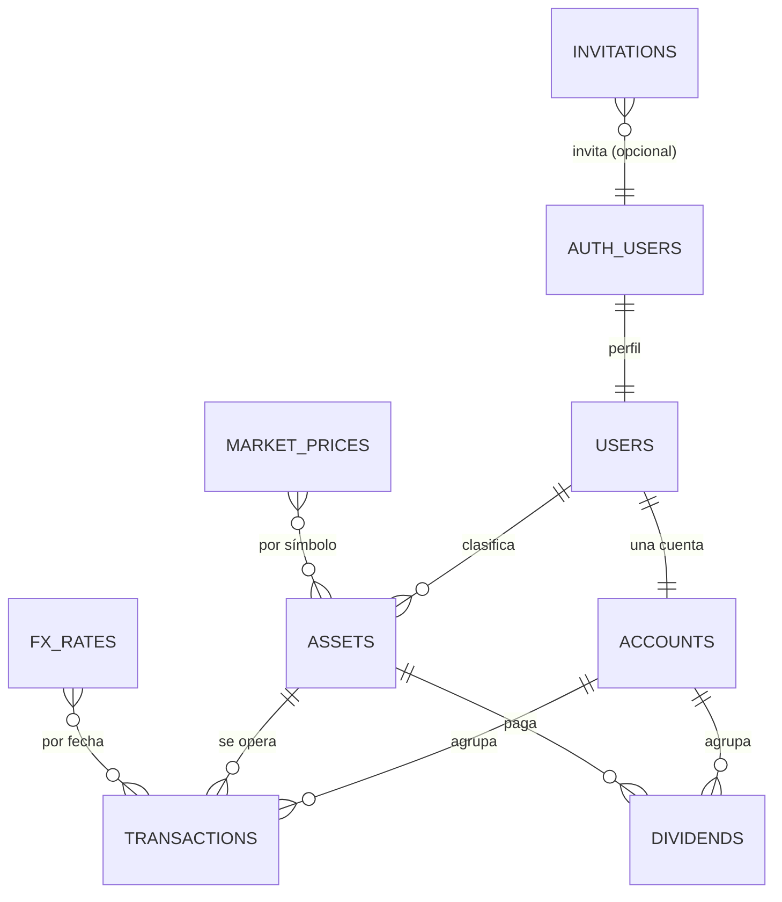

# 02 · Esquema de base de datos (Supabase / PostgreSQL)

## 1. Convenciones

- Nombres en `snake_case`, tablas en plural.
- Claves primarias `uuid` con `gen_random_uuid()`.
- Fechas de negocio en `date`; marcas técnicas en `timestamptz`.
- Importes monetarios: `numeric(20, 8)`. Cantidades: `numeric(28, 10)`. Tipos de cambio: `numeric(20, 10)`.
- Códigos de divisa y país como dominios `currency_code` / `country_code` (texto + `CHECK`); evitan el relleno de `char(n)`.
- Todo dato de usuario lleva `user_id` y política RLS. La única excepción son las cachés globales de mercado (sin datos personales).
- Los datos derivados (posiciones, plusvalías, rentabilidad) **no se almacenan**: se calculan en la API para que una edición o borrado no deje valores obsoletos.

## 2. Diagrama entidad-relación



Notas:

- `auth.users` lo gestiona Supabase. `public.users` es el perfil de la aplicación, en relación 1:1.
- `accounts` tiene `UNIQUE(user_id)`: garantiza exactamente una cuenta por usuario.
- `market_prices` y `fx_rates` son cachés globales keyed por símbolo/fecha, no por usuario.

## 3. Tablas

### 3.1 `public.users` — perfil y preferencias

| Columna | Tipo | Restricciones |
|---|---|---|
| `id` | `uuid` | PK, `REFERENCES auth.users(id) ON DELETE CASCADE` |
| `display_name` | `text` | `NOT NULL`, longitud 1–80 |
| `base_currency` | `currency_code` | `NOT NULL DEFAULT 'EUR'`, en la lista de divisas |
| `cost_method` | `text` | `NOT NULL DEFAULT 'FIFO'`, `CHECK IN ('FIFO','AVERAGE')` |
| `benchmark_symbol` | `text` | `NULL DEFAULT 'URTH'`, longitud ≤ 20 |
| `theme` | `text` | `NOT NULL DEFAULT 'system'`, `CHECK IN ('light','dark','system')` |
| `created_at` | `timestamptz` | `NOT NULL DEFAULT now()` |
| `updated_at` | `timestamptz` | `NOT NULL DEFAULT now()` |

Decisiones:

- No se duplica el email: se obtiene de Supabase Auth. Evita desincronización si el usuario cambia de correo.
- `cost_method` es global por usuario, tal como se acordó.
- `benchmark_symbol` se inicializa a `URTH` (MSCI World); vacío o `NULL` desactiva la comparación.

### 3.2 `public.accounts` — cuenta única por usuario

| Columna | Tipo | Restricciones |
|---|---|---|
| `id` | `uuid` | PK, `DEFAULT gen_random_uuid()` |
| `user_id` | `uuid` | `NOT NULL UNIQUE REFERENCES public.users(id) ON DELETE CASCADE` |
| `name` | `text` | `NOT NULL DEFAULT 'Mi cartera'`, longitud 1–80 |
| `created_at` | `timestamptz` | `NOT NULL DEFAULT now()` |
| `updated_at` | `timestamptz` | `NOT NULL DEFAULT now()` |

`UNIQUE(user_id)` es la garantía de la relación 1:1. No hacen falta más cuentas.

### 3.3 `public.assets` — activos y su clasificación

| Columna | Tipo | Restricciones |
|---|---|---|
| `id` | `uuid` | PK |
| `user_id` | `uuid` | `NOT NULL REFERENCES public.users(id) ON DELETE CASCADE` |
| `symbol` | `text` | `NOT NULL`, `CHECK (symbol ~ '^[A-Z0-9.\\-^=]{1,20}$')` |
| `name` | `text` | `NOT NULL`, longitud 1–120 |
| `asset_type` | `text` | `NOT NULL`, `CHECK IN ('STOCK','CRYPTO','ETF','FUND','BOND')` |
| `sector` | `text` | `NULL`, longitud ≤ 80 |
| `country` | `country_code` | `NULL`, `CHECK (country ~ '^[A-Z]{2}$')` |
| `currency` | `currency_code` | `NOT NULL`, en la lista de divisas |
| `exchange` | `text` | `NULL`, longitud ≤ 40 |
| `isin` | `text` | `NULL`, longitud ≤ 12 |
| `price_mode` | `text` | `NOT NULL DEFAULT 'AUTO'`, `CHECK IN ('AUTO','MANUAL')` |
| `manual_price` | `numeric(20,8)` | `NULL`, `CHECK (manual_price IS NULL OR manual_price > 0)` |
| `manual_price_currency` | `currency_code` | `NULL`, en la lista de divisas |
| `manual_price_at` | `timestamptz` | `NULL` |
| `notes` | `text` | `NULL`, longitud ≤ 1000 |
| `created_at` | `timestamptz` | `NOT NULL DEFAULT now()` |
| `updated_at` | `timestamptz` | `NOT NULL DEFAULT now()` |

Restricciones adicionales:

```sql
UNIQUE (user_id, symbol)
CHECK (
  price_mode = 'AUTO'
  OR (manual_price IS NOT NULL AND manual_price_currency IS NOT NULL)
)
```

Decisiones:

- El tipo de activo es texto con `CHECK` en lugar de una tabla de referencia: es más simple y cumple el requisito. Si en el futuro se añaden tipos, se amplía el `CHECK`.
- `sector` es texto libre con sugerencias en la interfaz (sectores GICS), porque no todos los activos encajan en una lista cerrada.
- `price_mode = 'MANUAL'` permite seguir valorando activos sin cobertura en Yahoo. En histórico se usa el precio del proveedor si existe; el manual solo afecta a la valoración actual.
- `symbol` usa el símbolo canónico del proveedor (por ejemplo `AAPL`, `BTC-USD`, `IWDA.AS`, `^GSPC`).

### 3.4 `public.transactions` — compras y ventas

| Columna | Tipo | Restricciones |
|---|---|---|
| `id` | `uuid` | PK |
| `user_id` | `uuid` | `NOT NULL REFERENCES public.users(id) ON DELETE CASCADE` |
| `account_id` | `uuid` | `NOT NULL REFERENCES public.accounts(id) ON DELETE CASCADE` |
| `asset_id` | `uuid` | `NOT NULL REFERENCES public.assets(id) ON DELETE RESTRICT` |
| `type` | `text` | `NOT NULL`, `CHECK IN ('BUY','SELL')` |
| `trade_date` | `date` | `NOT NULL` |
| `quantity` | `numeric(28,10)` | `NOT NULL`, `CHECK (quantity > 0)` |
| `unit_price` | `numeric(20,8)` | `NOT NULL`, `CHECK (unit_price >= 0)` |
| `fees` | `numeric(20,8)` | `NOT NULL DEFAULT 0`, `CHECK (fees >= 0)` |
| `currency` | `currency_code` | `NOT NULL`, en la lista de divisas |
| `fx_rate_eur` | `numeric(20,10)` | `NOT NULL`, `CHECK (fx_rate_eur > 0)` |
| `fx_rate_date` | `date` | `NOT NULL` |
| `fx_rate_source` | `text` | `NOT NULL DEFAULT 'AUTO'`, `CHECK IN ('AUTO','MANUAL')` |
| `notes` | `text` | `NULL`, longitud ≤ 1000 |
| `created_at` | `timestamptz` | `NOT NULL DEFAULT now()` |
| `updated_at` | `timestamptz` | `NOT NULL DEFAULT now()` |

Decisiones:

- `fx_rate_eur` es **EUR por 1 unidad de `currency`** en `fx_rate_date`. Para EUR vale `1`. Se guarda el snapshot para que la plusvalía histórica no cambie con el mercado.
- `unit_price` y `fees` están en `currency`, no en EUR. La conversión se hace con el snapshot.
- `ON DELETE RESTRICT` en `asset_id`: no se puede borrar un activo con operaciones; se devuelve `409 ASSET_IN_USE`.
- La regla “no vender más de lo que se tiene” y la coherencia temporal se validan en la API, porque requieren el historial completo. No se implementa con triggers.
- No se almacena la plusvalía realizada: depende del método elegido y del historial; se calcula al leer.

### 3.5 `public.dividends` — dividendos cobrados

| Columna | Tipo | Restricciones |
|---|---|---|
| `id` | `uuid` | PK |
| `user_id` | `uuid` | `NOT NULL REFERENCES public.users(id) ON DELETE CASCADE` |
| `account_id` | `uuid` | `NOT NULL REFERENCES public.accounts(id) ON DELETE CASCADE` |
| `asset_id` | `uuid` | `NOT NULL REFERENCES public.assets(id) ON DELETE RESTRICT` |
| `payment_date` | `date` | `NOT NULL` |
| `gross_amount` | `numeric(20,8)` | `NOT NULL`, `CHECK (gross_amount > 0)` |
| `withholding_tax` | `numeric(20,8)` | `NOT NULL DEFAULT 0`, `CHECK (withholding_tax >= 0)` |
| `currency` | `currency_code` | `NOT NULL`, en la lista de divisas |
| `fx_rate_eur` | `numeric(20,10)` | `NOT NULL`, `CHECK (fx_rate_eur > 0)` |
| `fx_rate_date` | `date` | `NOT NULL` |
| `fx_rate_source` | `text` | `NOT NULL DEFAULT 'AUTO'`, `CHECK IN ('AUTO','MANUAL')` |
| `notes` | `text` | `NULL`, longitud ≤ 1000 |
| `created_at` | `timestamptz` | `NOT NULL DEFAULT now()` |
| `updated_at` | `timestamptz` | `NOT NULL DEFAULT now()` |

Restricción clave:

```sql
CHECK (withholding_tax <= gross_amount)
```

El neto (`gross_amount - withholding_tax`) se calcula, no se almacena.

### 3.6 `public.invitations` — invitaciones de registro

| Columna | Tipo | Restricciones |
|---|---|---|
| `id` | `uuid` | PK |
| `email` | `citext` | `NOT NULL`, formato válido |
| `token_hash` | `text` | `NOT NULL UNIQUE`, 64 hex (SHA-256) |
| `expires_at` | `timestamptz` | `NOT NULL` |
| `accepted_at` | `timestamptz` | `NULL` |
| `created_by` | `uuid` | `NULL`, `REFERENCES auth.users(id) ON DELETE SET NULL` |
| `created_at` | `timestamptz` | `NOT NULL DEFAULT now()` |

Índices y restricciones:

```sql
CREATE UNIQUE INDEX invitations_pending_email
  ON public.invitations (email)
  WHERE accepted_at IS NULL;

CREATE INDEX invitations_pending_expiry
  ON public.invitations (expires_at)
  WHERE accepted_at IS NULL;

CHECK (expires_at > created_at)
```

Decisiones:

- Se guarda el **hash** del token, nunca el token en claro. El enlace se genera una vez por CLI.
- Solo puede haber una invitación pendiente por email.
- `accepted_at` se marca de forma atómica al consumirla (una invitación es de un solo uso).
- Esta tabla no existía en el enunciado original; es necesaria para el registro solo por invitación acordado.

### 3.7 `public.market_prices` — caché global de cotizaciones históricas

| Columna | Tipo | Restricciones |
|---|---|---|
| `symbol` | `text` | `NOT NULL`, longitud 1–20 |
| `price_date` | `date` | `NOT NULL` |
| `close_price` | `numeric(20,8)` | `NOT NULL`, `CHECK (close_price > 0)` |
| `currency` | `currency_code` | `NOT NULL`, en la lista de divisas |
| `source` | `text` | `NOT NULL DEFAULT 'yahoo'` |
| `fetched_at` | `timestamptz` | `NOT NULL DEFAULT now()` |
| | | `PRIMARY KEY (symbol, price_date)` |

- Guarda cierres diarios; la cotización actual es la fila más reciente.
- No lleva `user_id`: es un dato público de mercado y compartido entre usuarios.
- La escritura la hace solo el planificador con `service_role`.

### 3.8 `public.fx_rates` — caché global de tipos de cambio

| Columna | Tipo | Restricciones |
|---|---|---|
| `base_currency` | `currency_code` | `NOT NULL`, `CHECK (base_currency = 'EUR')` |
| `quote_currency` | `currency_code` | `NOT NULL`, en la lista de divisas |
| `rate_date` | `date` | `NOT NULL` |
| `rate` | `numeric(20,10)` | `NOT NULL`, `CHECK (rate > 0)` |
| `source` | `text` | `NOT NULL DEFAULT 'frankfurter'` |
| `fetched_at` | `timestamptz` | `NOT NULL DEFAULT now()` |
| | | `PRIMARY KEY (base_currency, quote_currency, rate_date)` |

- `rate` significa **1 EUR = `rate` unidades de `quote_currency`**. Se normaliza así aunque el proveedor devuelva la inversa.
- Para obtener EUR por unidad: `1 / rate`.
- Todas las conversiones pasan por EUR, incluso entre dos divisas no euro.

## 4. Lista de divisas soportadas

Se usa una lista cerrada y se replica en un `CHECK` de PostgreSQL y en una constante compartida del código. Divisa base por defecto: `EUR`.

```text
EUR, USD, GBP, CHF, CAD, AUD, JPY, SEK, NOK, DKK, PLN, CZK, HKD, SGD
```

Ampliar la lista requiere una migración que reemplace el `CHECK`. Es un compromiso consciente para mantener la integridad sin una tabla de referencia.

## 5. Row Level Security (RLS)

Todas las tablas tienen RLS activado. `service_role` omite RLS por diseño de Supabase y solo se usa en el CLI de invitaciones y en el planificador de precios.

### 5.1 Patrón general

```sql
ALTER TABLE public.assets ENABLE ROW LEVEL SECURITY;

CREATE POLICY assets_select_own ON public.assets
  FOR SELECT TO authenticated
  USING (user_id = (SELECT auth.uid()));

CREATE POLICY assets_insert_own ON public.assets
  FOR INSERT TO authenticated
  WITH CHECK (user_id = (SELECT auth.uid()));

CREATE POLICY assets_update_own ON public.assets
  FOR UPDATE TO authenticated
  USING (user_id = (SELECT auth.uid()))
  WITH CHECK (user_id = (SELECT auth.uid()));

CREATE POLICY assets_delete_own ON public.assets
  FOR DELETE TO authenticated
  USING (user_id = (SELECT auth.uid()));
```

Se repite el patrón en `accounts`, `transactions` y `dividends`. En `users` el predicado es `id = (SELECT auth.uid())`.

### 5.2 Políticas por tabla

| Tabla | SELECT | INSERT | UPDATE | DELETE |
|---|---|---|---|---|
| `users` | propio `id` | — (lo crea el trigger) | propio `id` | — (se borra desde Auth) |
| `accounts` | propio `user_id` | propio `user_id` | propio `user_id` | propio `user_id` |
| `assets` | propio `user_id` | propio `user_id` | propio `user_id` | propio `user_id` |
| `transactions` | propio `user_id` | propio `user_id` | propio `user_id` | propio `user_id` |
| `dividends` | propio `user_id` | propio `user_id` | propio `user_id` | propio `user_id` |
| `invitations` | denegado | denegado | denegado | denegado |
| `market_prices` | cualquier `authenticated` | denegado | denegado | denegado |
| `fx_rates` | cualquier `authenticated` | denegado | denegado | denegado |

Para las tablas globales se añade además:

```sql
REVOKE INSERT, UPDATE, DELETE ON public.market_prices FROM anon, authenticated;
REVOKE INSERT, UPDATE, DELETE ON public.fx_rates FROM anon, authenticated;
```

Para `invitations`, una política explícita de denegación deja constancia de la intención:

```sql
CREATE POLICY invitations_no_access ON public.invitations
  FOR ALL TO anon, authenticated
  USING (false) WITH CHECK (false);
```

### 5.3 Por qué el filtro también va en la API

RLS es la última línea de defensa, no la única. La API:

1. Verifica el JWT y obtiene `user.id`.
2. Crea un cliente de Supabase con el access token del usuario y la `anon key`.
3. Añade siempre `.eq('user_id', user.id)` en consultas y escrituras.
4. Nunca acepta `user_id` desde el cliente.
5. Devuelve `404` (no `403`) al pedir un recurso ajeno, para no filtrar su existencia.

Así, un fallo en una política no se convierte automáticamente en una fuga de datos.

## 6. Triggers

### 6.1 Perfil y cuenta automáticos

Al crear un usuario en `auth.users` (registro por invitación), se crean el perfil y su cuenta:

```sql
CREATE OR REPLACE FUNCTION public.handle_new_user()
RETURNS trigger
LANGUAGE plpgsql
SECURITY DEFINER
SET search_path = public, pg_temp
AS $$
BEGIN
  INSERT INTO public.users (id, display_name)
  VALUES (
    NEW.id,
    COALESCE(NULLIF(NEW.raw_user_meta_data->>'display_name', ''), 'Inversor')
  )
  ON CONFLICT (id) DO NOTHING;

  INSERT INTO public.accounts (user_id)
  VALUES (NEW.id)
  ON CONFLICT (user_id) DO NOTHING;

  RETURN NEW;
END;
$$;

CREATE TRIGGER on_auth_user_created
  AFTER INSERT ON auth.users
  FOR EACH ROW EXECUTE FUNCTION public.handle_new_user();

REVOKE EXECUTE ON FUNCTION public.handle_new_user() FROM PUBLIC, anon, authenticated;
```

### 6.2 `updated_at`

Función genérica `public.set_updated_at()` asignada a `users`, `accounts`, `assets`, `transactions` y `dividends`.

## 7. Índices

| Tabla | Índice | Uso |
|---|---|---|
| `assets` | `UNIQUE (user_id, symbol)` | Evitar duplicados por usuario. |
| `assets` | `(user_id, asset_type)` | Filtro por tipo. |
| `transactions` | `(user_id, trade_date DESC, id DESC)` | Listado paginado y evolución. |
| `transactions` | `(user_id, asset_id, trade_date, id)` | Historial por activo y FIFO. |
| `transactions` | `(account_id, trade_date)` | Filtro por cuenta (una por usuario). |
| `transactions` | `(user_id, type, trade_date)` | Compras/ventas por periodo. |
| `dividends` | `(user_id, payment_date DESC, id DESC)` | Listado paginado. |
| `dividends` | `(user_id, asset_id, payment_date)` | Dividendos por activo. |
| `dividends` | `(account_id, payment_date)` | Filtro por cuenta. |
| `invitations` | `UNIQUE (token_hash)` | Búsqueda al aceptar. |
| `invitations` | parcial `(email) WHERE accepted_at IS NULL` | Una pendiente por email. |
| `market_prices` | PK `(symbol, price_date)` | Última cotización e histórico. |
| `fx_rates` | PK `(base_currency, quote_currency, rate_date)` | Último cambio e histórico. |

No se añaden índices de texto: el volumen de una cartera personal es bajo y los filtros se hacen en memoria tras cargar los activos del usuario.

## 8. Acceso desde Express

- **Cliente de usuario:** `createClient(SUPABASE_URL, SUPABASE_ANON_KEY, { global: { headers: { Authorization: 'Bearer <access_token>' } }, auth: { persistSession: false, autoRefreshToken: false } })`. RLS se aplica con `auth.uid()`.
- **Cliente administrativo:** `createClient(SUPABASE_URL, SUPABASE_SERVICE_ROLE_KEY, { auth: { persistSession: false, autoRefreshToken: false } })`. Solo en:
  - CLI de invitaciones (`createUser`, consulta de invitaciones).
  - Inserción de precios y tipos de cambio por el planificador.
  - Nunca en una petición HTTP normal.
- **Verificación del JWT:** `jose` contra el JWKS de Supabase (`/auth/v1/.well-known/jwks.json`), con caché de claves. Se valida `iss`, `aud = authenticated`, `exp` y `sub`. No se llama a `getUser` en cada petición.
- **Rotación de tokens:** Supabase Auth emite el access token y el refresh token; Express los guarda en cookies. El refresh se hace contra Supabase y se reescriben ambas cookies.

## 9. Datos derivados (no almacenados)

| Dato | Cómo se obtiene |
|---|---|
| Cantidad de una posición | Suma de compras − ventas por activo. |
| Coste medio | FIFO o media ponderada, según `users.cost_method`. |
| Plusvalía realizada | Consumo de lotes en cada venta. |
| Plusvalía no realizada | Valor de mercado − coste de lotes abiertos. |
| Dividendos acumulados | Suma de dividendos netos convertidos a EUR. |
| Valor de la cartera | Σ cantidad × precio actual × cambio actual. |
| TWR / XIRR | Serie diaria de valor + flujos + dividendos. |

Se recalculan en cada lectura. Con miles de operaciones el coste es despreciable y se evita introducir tablas de estado que puedan desincronizarse.

## 10. Desviaciones conscientes del enunciado

1. **Invitaciones:** tabla y CLI en lugar de registro público, por decisión del usuario.
2. **Divisas:** lista de 14 divisas en lugar de solo EUR/USD, por decisión del usuario.
3. **Cachés de mercado:** `market_prices` y `fx_rates` no son datos de usuario, pero son necesarias para que el dashboard sea rápido y resistente a fallos del proveedor.
4. **Sin tablas de FIFO ni de contraseñas:** se mantiene la indicación del enunciado; esos cálculos y la gestión de credenciales viven en la API/Supabase Auth.
